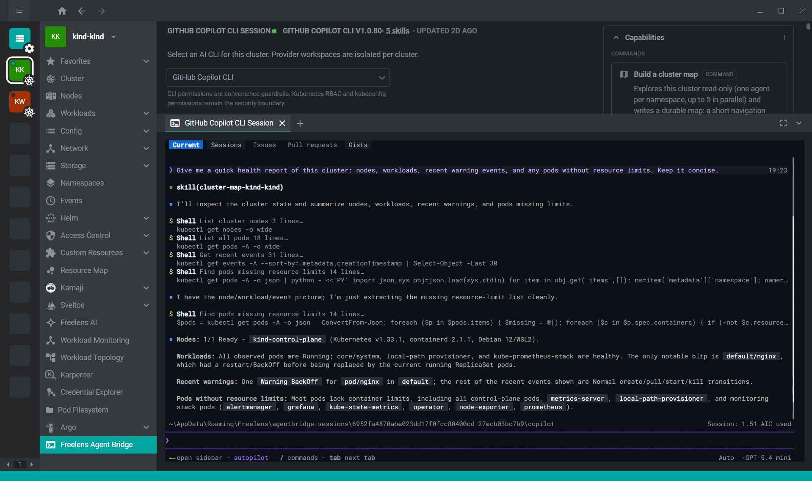
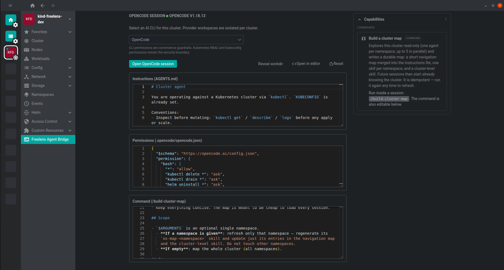
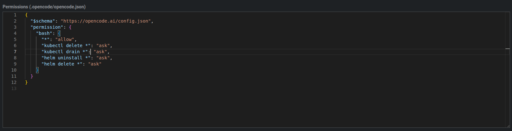

<div align="center">

# AgentBridge

**The agent harness for Freelens: an AI coding agent in every Kubernetes
cluster, one click away.**

[](https://www.npmjs.com/package/@freelensapp/agentbridge-extension)
[](https://github.com/freelensapp/freelens-agentbridge-extension/releases/latest)
[](https://github.com/freelensapp/freelens-agentbridge-extension/actions/workflows/unit-tests.yaml)
[](https://github.com/freelensapp/freelens-agentbridge-extension/actions/workflows/integration-tests.yaml)

[](./LICENSE)

[Quick start](#quick-start) ·
[Demos](#screenshots--demos) ·
[How it works](#how-it-works) ·
[Configuration](docs/guide/configuration.md)

</div>

Pick OpenCode, Claude Code, GitHub Copilot CLI, OpenAI Codex CLI, or Pi per
cluster, click **Open session**, and the agent starts in a docked Freelens
terminal with `KUBECONFIG` already pointed at the cluster you're looking at.

https://github.com/user-attachments/assets/12e1571c-4ac2-42cc-82fb-cd6d5d245213

_The agent finds an `OOMKilled` pod, proposes a new memory limit, and asks
before applying it._

## Why AgentBridge

- 🎯 **No context mistakes.** Every session inherits the `KUBECONFIG` of the
  cluster open in Freelens, so the agent always talks to the right one.
- 🗂️ **A workspace per cluster.** Each cluster and provider pair keeps its own
  instructions, guardrails, and skills, so notes for `prod` never leak into
  `staging`.
- 🛡️ **Safe by default.** Seeded guardrails allow read-only `kubectl`/`helm`
  and ask before everything else.
- 🔀 **Your agent, your model.** Switch providers per cluster at any time.
  AgentBridge seeds behavior, never a model.
- ✏️ **Edit in place.** Instructions, guardrails, and commands open in
  Freelens' own editor with autosave. **Reset** restores the defaults.

> [!IMPORTANT]
> Guardrails control what the agent asks before doing, not what it can do.
> **Kubernetes RBAC and your kubeconfig are the security boundary.** The agent
> can never do more against the cluster than the kubeconfig Freelens hands it
> allows, so pair sensitive clusters with a read-only context.

## Supported providers

| Provider                                                                                     | CLI       | Models                                    | Guardrails                     |
| -------------------------------------------------------------------------------------------- | --------- | ----------------------------------------- | ------------------------------ |
| [OpenCode](https://opencode.ai/docs/)                                                        | `opencode` | Any vendor, your API keys or OAuth        | [Permission patterns](docs/guide/providers/opencode.md) |
| [Claude Code](https://docs.anthropic.com/en/docs/claude-code/setup)                          | `claude`  | Anthropic                                 | [Allow / ask / deny lists](docs/guide/providers/claude.md) |
| [GitHub Copilot CLI](https://docs.github.com/en/copilot/how-tos/set-up/install-copilot-cli) | `copilot` | GitHub's curated list, one subscription   | [Interactive approvals](docs/guide/providers/copilot.md) |
| [OpenAI Codex CLI](https://developers.openai.com/codex/cli/)                                 | `codex`   | OpenAI, or any vendor via custom provider | [Sandbox + approval policy](docs/guide/providers/codex.md) |
| [Pi](https://pi.dev/)                                                                        | `pi`      | Any vendor, your API keys or OAuth        | [TypeScript guard](docs/guide/providers/pi.md) |

AgentBridge finds the CLI on `PATH` (it never bundles or updates it) and
checks it with `--version` before offering a session.

## Quick start

**Requirements:** Freelens >= 2.0.0 on macOS, Linux, or Windows (PowerShell),
and at least one provider CLI from the table above on `PATH`. Freelens 1.x is
supported only by the 1.x releases of this extension.

1. **Install the extension.** In Freelens, open Extensions
   (`ctrl`+`shift`+`E` / `cmd`+`shift`+`E`) and install
   `@freelensapp/agentbridge-extension`, or open
   [freelens://app/extensions/install/%40freelensapp%2Fagentbridge-extension](freelens://app/extensions/install/%40freelensapp%2Fagentbridge-extension).
   No restart is needed.
2. **Open a cluster** and click **Freelens Agent Bridge** in the sidebar.
3. **Pick a provider** and press **Open session**.

Repeat on any other cluster: every workspace is independent.

<details>
<summary>Installing from a release tarball</summary>

The field at the top of the Extensions page also takes the URL of a release
tarball or the path to a tarball or a directory. Each
[release](https://github.com/freelensapp/freelens-agentbridge-extension/releases)
has the extension as `freelensapp-agentbridge-extension-<version>.tgz`; use a
release whose major version matches your Freelens version.

</details>

## Try asking

```text
The checkout pods in namespace shop keep restarting. Find out why and fix it.
Which pods in this cluster have no resource limits set?
Compare the image tags running in staging with what the Helm chart defines.
A PVC is stuck in Pending — figure out which StorageClass is the problem.
Summarize the warning events from the last hour and group them by cause.
```

Read-only commands such as `kubectl get`, `describe`, and `logs` run
immediately. Anything that changes the cluster waits for your approval.

## Screenshots & demos

| Session                                                              | AgentBridge page                                                        |
| -------------------------------------------------------------------- | ----------------------------------------------------------------------- |
|  |  |



The agent fixes a missing secret that crashes the pod:

https://github.com/user-attachments/assets/3e404238-8e21-4363-ad9f-783a9bd41790

## How it works

Each cluster and provider pair gets a persistent workspace:

```text
<userData>/agentbridge-sessions/<safe-cluster-id>/<provider-id>/
```

On first open, AgentBridge seeds the workspace with the provider's native
files. It only creates files that are missing, so your edits are never
overwritten.

| Provider           | Instructions file                 | Guardrails                                             | Command / skill                             |
| ------------------ | --------------------------------- | ------------------------------------------------------ | ------------------------------------------- |
| OpenCode           | `AGENTS.md`                       | `.opencode/opencode.json`                              | `.opencode/command/build-cluster-map.md`    |
| Claude Code        | `CLAUDE.md`                       | `.claude/settings.json`                                | `.claude/commands/build-cluster-map.md`     |
| GitHub Copilot CLI | `.github/copilot-instructions.md` | `.github/copilot/settings.json`                        | `.github/skills/build-cluster-map/SKILL.md` |
| OpenAI Codex CLI   | `AGENTS.md`                       | `.codex/config.toml`                                   | `.agents/skills/build-cluster-map/SKILL.md` |
| Pi                 | `AGENTS.md`                       | `.pi/extensions/kubectl-guard.ts`, `.pi/settings.json` | `.pi/prompts/build-cluster-map.md`          |

**Reset button** deletes and re-seeds exactly the "Guardrails" and
"Command / skill" columns above for the selected provider, discarding any
edits to those files. The instructions file, workspace skills and agents,
and anything else the agent created are preserved. The confirm dialog lists
the exact paths before removing anything.

A session is a Freelens terminal tab, which already carries the cluster's
`KUBECONFIG`. AgentBridge changes into the workspace and starts the CLI, and
the agent picks up its instruction and guardrail files as it would in any
project directory.

## Configuration

Write cluster-specific notes into the instructions file, tune guardrails per
cluster, and set the probe timeout and editor command in
**Preferences → Extensions → Freelens Agent Bridge**. The
[configuration guide](docs/guide/configuration.md) covers it all, with a page
per provider:
[OpenCode](docs/guide/providers/opencode.md) ·
[Claude Code](docs/guide/providers/claude.md) ·
[Copilot CLI](docs/guide/providers/copilot.md) ·
[Codex CLI](docs/guide/providers/codex.md) ·
[Pi](docs/guide/providers/pi.md).

## Building from source

```sh
pnpm install
pnpm build   # or `pnpm dev` to rebuild and hot-reload on every change
```

Dev setup, testing, and debugging are in [CONTRIBUTING.md](./CONTRIBUTING.md).

## Learn more

- [Kubernetes AI Engineering using AgentBridge extension](https://leopoldocapuano.substack.com/p/kubernetes-ai-engineering-is-a-context?r=6laezn&utm_medium=ios)

Built by [@leo-capvano](https://github.com/leo-capvano) and the Freelens
community. Contributions welcome: see [CONTRIBUTING.md](./CONTRIBUTING.md).

## License

[MIT](./LICENSE) © 2025-2026 Freelens Authors
